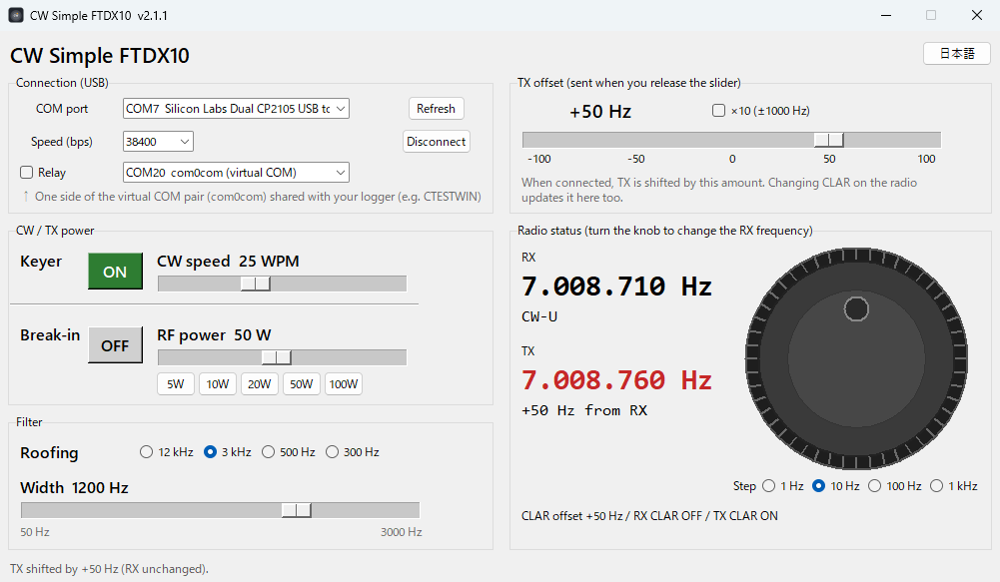

# CW Simple FTDX10

[日本語](README.md)

### [⬇ Download (latest exe)](https://github.com/nqf18003/cw-simple-ftdx10/releases/latest)
On that page, click `CW_Simple_FTDX10.exe` under **Assets** to download it.

A small Windows program (unofficial) that connects to a **YAESU FTDX10** over USB (CAT) and puts only the controls you often use for CW on your PC screen.
The screen can be switched between English and Japanese.



## Features
- **Shift only the TX frequency (TX CLAR)**: a slider shifts the TX frequency by ±100 Hz (±1000 Hz with "×10").
  TX CLAR is turned on automatically when you connect. This helps you avoid calling exactly on the other station's frequency.
  If you turn the CLAR knob on the radio, the screen follows it.
- **RX frequency knob**: turn the big knob to change the RX frequency (VFO-A). The step can be 1 Hz / 10 Hz / 100 Hz / 1 kHz.
  Pressing a step button rounds the current frequency to that step.
- **Keyer ON/OFF and Break-in ON/OFF**: one button each.
- **CW speed** (4–60 WPM) and **RF power** (5–100 W, with 5/10/20/50/100 W buttons): sliders.
- **Filter**: roofing filter (12 kHz / 3 kHz / 500 Hz / 300 Hz) and width. The width slider range follows the roofing filter.
- **Relay for logging software**: with com0com (virtual COM ports), a logger such as CTESTWIN can use the same radio through this program (see "Relay for logging software" below).

Settings that are buried in the radio's menus (keyer, CW speed, break-in, RF power) are always on the screen in front of you.

> **Tested with the FTDX10 only.** Other YAESU radios use slightly different CAT commands, so it may not work with them.

## Requirements
- Windows 10 / 11
- YAESU FTDX10
- USB cable (between the radio's USB port and the PC)
- YAESU USB driver (Virtual COM Port Driver, available from the YAESU website)

## How to use
1. Download `CW_Simple_FTDX10.exe` from the [latest release page](https://github.com/nqf18003/cw-simple-ftdx10/releases/latest).
2. Double-click it. No installation is needed.
   - The first time, Windows may show "**Windows protected your PC**" (SmartScreen), because the exe is not digitally signed.
     Click "**More info**", then "**Run anyway**".
3. For "COM port", choose the FTDX10's **Enhanced COM Port** (not the Standard COM Port).
4. Set "Speed (bps)" to the same value as the radio's "CAT RATE" menu (usually 38400).
   If it is different, the program tries 4800 / 9600 / 19200 / 38400 when connecting.
5. Press "Connect". When connected, TX is shifted by the slider amount (TX CLAR ON).
6. Use the button at the top right ("日本語" / "English") to switch the language.

## Relay for logging software (optional)
A COM port can be opened by only one program, so to use a logger (such as CTESTWIN) at the same time,
this program sits in the middle and passes the logger's commands to the radio.

```
FTDX10 ──USB── this program ──COM20⇔COM21 (com0com)── logger
```

1. **Install com0com** (once)
   1. Download **com0com-2.2.2.0-x64-fre-signed.zip** from https://sourceforge.net/projects/com0com/files/com0com/2.2.2.0/
      - Choose the one with **signed** in its name.
      - The newer 3.0.0.0 failed on Windows 11 with "Code 52 (cannot verify the digital signature)". In that case use 2.2.2.0.
   2. Unzip it, right-click the setup exe and choose "Run as administrator" to install it.
   3. In "Setup for com0com", rename CNCA0 to **COM20** and CNCB0 to **COM21**, then press "Apply"
      (any unused numbers are fine).
   - Do not change your PC's security settings (test signing, Secure Boot, etc.).
2. **This program**: after connecting to the FTDX10, choose **COM20** in the list next to "Relay" and check "Relay".
   "Relaying" appears in green when it works. From then on, the relay starts automatically when you connect.
3. **Logger**: set the radio to FTDX10, the COM port to **COM21**, and the speed to the same value as this program (usually 38400).

- Start this program and connect before starting the logger.
- If you key CW or PTT with the Standard COM Port signals, keep that connection direct as before (it is not relayed).
- If the logger tries to turn on Auto Information (AI), this program blocks it so that replies do not get mixed up.

## Where data is stored
- Settings (COM port, speed, offset, language, etc.) are saved in `cw_simple_settings.json` in the same folder as the exe.
- The program talks only to the radio over USB (and to the virtual COM port when relaying). Nothing is sent to the internet.

## Run from source / build the exe
Python 3 is required.

```powershell
python -m venv .venv
.\.venv\Scripts\python.exe -m pip install pyserial pyinstaller
.\.venv\Scripts\python.exe cw_simple_ftdx10.py --selftest
.\.venv\Scripts\python.exe cw_simple_ftdx10.py
.\.venv\Scripts\pyinstaller.exe --noconfirm --onefile --windowed --icon icon.ico --name CW_Simple_FTDX10 cw_simple_ftdx10.py
```

`--selftest` runs a self-test against a simulated radio (no radio needed).

## Notes
- This is an unofficial program made by an individual. It is not affiliated with YAESU.
- Use it at your own risk. Before transmitting, check the frequency and offset on the radio's display.
- Most of the code and documentation was written with AI (Anthropic's Claude).

## License
MIT License ([LICENSE](LICENSE))
