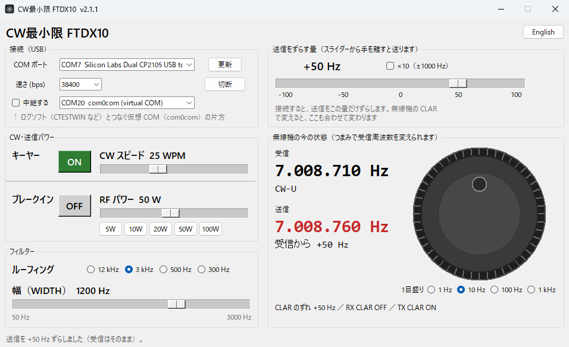

# CW最小限 FTDX10（CW Simple FTDX10）

[English version](README.en.md)

### [⬇ ダウンロード（最新版の exe）](https://github.com/nqf18003/cw-simple-ftdx10/releases/latest)
リンク先のページの下にある **Assets** の `CW_Simple_FTDX10.exe` を押すとダウンロードできます。

八重洲（YAESU）の無線機 **FTDX10** を USB（CAT）でつなぎ、CW の運用でよく使う操作だけをパソコンの画面でできるようにした Windows のソフトです（非公式）。
画面は日本語と英語を切り替えられます。



## できること
- **送信だけずらす（TX CLAR）**：スライダーで、送信周波数だけを ±100 Hz（「×10」で ±1000 Hz）ずらします。
  接続すると自動で TX CLAR を ON にします。オンフレ（相手と同じ周波数）で呼ばないようにするためのものです。
  無線機の CLAR つまみで変えても、画面が合わせて変わります。
- **受信周波数のつまみ**：大きなつまみを回して、受信周波数（VFO-A）を変えます。1 目盛りは 1 Hz／10 Hz／100 Hz／1 kHz から選べます。
  目盛りのボタンを押すと、今の周波数をその単位で四捨五入します。
- **キーヤー ON/OFF・ブレークイン ON/OFF**：ボタン 1 つで切り替えます。
- **CW スピード**（4～60 WPM）・**RF パワー**（5～100 W、5/10/20/50/100 W のボタン付き）：スライダーで変えます。
- **フィルター**：ルーフィング（12 kHz／3 kHz／500 Hz／300 Hz）と幅（WIDTH）を変えます。幅のスライダーはルーフィングに合わせた範囲になります。
- **ログソフトとの中継**：com0com（仮想 COM ポート）を使うと、CTESTWIN などのログソフトも、このソフト経由で同じ無線機につなげます（下の「ログソフトとの中継」）。

本体のメニューの奥にある設定（キーヤー・CW スピード・ブレークイン・RF パワー）を、正面のパソコン画面からすぐ触れるようにしています。

> **テストした機種は FTDX10 だけです。** 八重洲のほかの機種は CAT コマンドが少しずつ違うことがあるので、動かないかもしれません。

## 必要なもの
- Windows 10 / 11
- YAESU FTDX10
- USB ケーブル（無線機の USB 端子とパソコンをつなぐもの）
- YAESU の USB ドライバ（Virtual COM Port Driver。八重洲のサイトから入手できます）

## 使い方
1. [最新版のページ](https://github.com/nqf18003/cw-simple-ftdx10/releases/latest)から `CW_Simple_FTDX10.exe` をダウンロードします。
2. ダブルクリックで起動します。インストールは要りません。
   - 初めて起動するとき、Windows が「**Windows によって PC が保護されました**」（SmartScreen）と出すことがあります。
     exe に電子署名がないためです。「**詳細情報**」を押してから「**実行**」を押してください。
3. 「COM ポート」で、FTDX10 の **Enhanced COM Port** の方を選びます（Standard COM Port の方ではありません）。
4. 「速さ (bps)」は、無線機のメニュー「CAT RATE」と同じにします（ふつうは 38400）。
   違っていても、接続するときに 4800／9600／19200／38400 を順に試します。
5. 「接続」を押します。つながると、スライダーの量で送信がずれます（TX CLAR ON）。
6. 右上のボタン（「English」／「日本語」）で、画面の言葉を切り替えられます。

## ログソフトとの中継（使う人だけ）
1 つの COM ポートは 1 つのソフトしか開けないので、ログソフト（CTESTWIN など）と一緒に使うときは、
このソフトが間に入って、ログソフトからの命令を無線機に伝えます。

```
FTDX10 ──USB── このソフト ──COM20⇔COM21（com0com）── ログソフト
```

1. **com0com を入れる**（1 回だけ）
   1. https://sourceforge.net/projects/com0com/files/com0com/2.2.2.0/ から **com0com-2.2.2.0-x64-fre-signed.zip** をダウンロードします。
      - 名前に **signed** と付いている方を選びます。
      - 新しい 3.0.0.0 は、Windows 11 で「コード 52（デジタル署名を確認できない）」になり動かないことがありました。そのときは 2.2.2.0 を使ってください。
   2. zip を展開し、setup の exe を右クリック →「管理者として実行」でインストールします。
   3. 「Setup for com0com」の画面で、CNCA0 の名前を **COM20**、CNCB0 の名前を **COM21** に書きかえて「Apply」を押します
      （ほかで使っていない番号なら何番でも構いません）。
   - パソコンの安全のための設定（テスト署名・セキュアブートなど）は変えないでください。
2. **このソフト**：FTDX10 に接続してから、「中継する」の右の一覧で **COM20** を選び、「中継する」にチェックを入れます。
   右に「中継中」と緑で出れば OK です。次からは接続すると自動で中継が始まります。
3. **ログソフト**：無線機は FTDX10、COM ポートは **COM21**、速さはこのソフトと同じ（ふつうは 38400）にします。

- ログソフトより先に、このソフトを起動して接続しておきます。
- CW のキーイングや PTT を Standard COM Port の信号で行っている場合、そちらは中継せず、これまでどおり直接つなぎます。
- ログソフトが「自動で状態を送り続ける」機能（AI）を ON にしようとしても、このソフトは止めます（返事が混ざらないように）。

## データの保存先
- 設定（COM ポート・速さ・ずらす量・言語など）は、exe と同じフォルダの `cw_simple_settings.json` に保存します。
- やりとりするのは、USB でつないだ無線機（と中継するときの仮想 COM ポート）だけです。インターネットには何も送りません。

## ソースから動かす・exe を作る
Python 3 が必要です。

```powershell
python -m venv .venv
.\.venv\Scripts\python.exe -m pip install pyserial pyinstaller
.\.venv\Scripts\python.exe cw_simple_ftdx10.py --selftest
.\.venv\Scripts\python.exe cw_simple_ftdx10.py
.\.venv\Scripts\pyinstaller.exe --noconfirm --onefile --windowed --icon icon.ico --name CW_Simple_FTDX10 cw_simple_ftdx10.py
```

`--selftest` は、にせの無線機を相手にした自己テストです（無線機は要りません）。

## ご注意
- 八重洲無線（YAESU）とは関係のない、個人が作った非公式のソフトです。
- 使うときは、ご自身の責任でお願いします。送信の前には、無線機の表示で周波数とずれを確かめてください。
- このソフトのプログラムと説明は、ほとんど AI（Anthropic の Claude）が作りました。

## ライセンス
MIT License（[LICENSE](LICENSE)）
